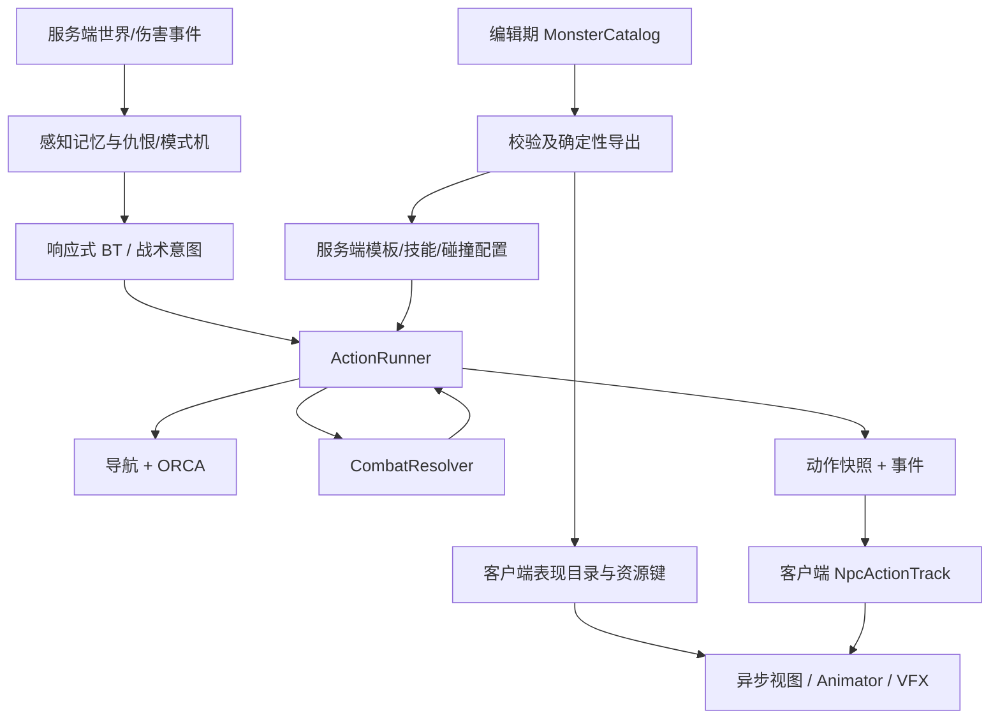

# 怪物 AI 运行时重构与联网动作一致性设计

日期：2026-11-08。
状态：**Draft — 待用户评审；本文件不是实现批准。**
检查：Unity 现状专家复核已完成；[独立 builder check](../reviews/2026-11-08-monster-ai-spec-builder-check.md) 发现的动作/时序歧义已修订，可据此制定实施计划。
工作流：Superpowers brainstorming → Unity 专家复核 → 本 spec → 独立 builder check → 用户评审 → writing-plans。

依据：[现状评审](../../Design/MonsterAiRefactorReview.md)、[Unity 专家复核](../reviews/2026-11-08-monster-ai-unity-expert-review.md)、各模块 README。

## 1. 意图、范围与决策来源

让现有联网怪物具备可继续扩展的选招、站位、追击和脱战能力，同时保证多个客户端呈现同一份服务器行为。首先修复动作、资源和同步合同，再增加战术选择。

### 1.1 用户已确定

- 审查、重构现有怪物资源和 AI，优先选招、走位、追击、脱战。
- 联网状态下各客户端怪物行为一致。
- **普通怪物攻击前摇被玩家命中时可打断；Boss／指定技能按霸体配置。**
- Bon 接入不属于本次；待重构完成并验收后再接入。

### 1.2 本 spec 提出的工程决定，等待完整设计评审

- 保留 Patrol / Combat / Evade / Dead 模式机和响应式 BT；新增 ActionRunner，不引入 GOAP、DOTS 或新第三方包。
- 选招先硬条件过滤，再作小规模确定性评分；加入意图保持和追击恢复。
- 本次保留并冻结现有完整单机玩法，不要求同步获得新 AI；不执行删除单机实现，也不顺带统一两套运行时。
- 模板 2 暂保留既有数值 ID 和 Wolf 逻辑身份；TurtleShell 是显式标记的临时视觉映射，不因此获得防御行为。
- 本文具体时长、评分权重、资源池容量属于建议初值，用户没有逐项确认；均配置化并通过验收再调参。

### 1.3 非目标与失败条件

非目标：Bon、新怪物内容、群体包围/协同、完整 Boss 多阶段、新防御玩法、Slime 嘲讽表演移植、完整 P3 状态系统、投射物/位移新技能、动态导航、多层地图、玩家移动权威化、新 NPC Full/Proxy 分档、单机 AI 删除/合并、引擎升级。

不可接受：客户端重新运行 AI；只取消动画却照常出伤；可靠事件静默丢失；为了同步把动画逐帧重启；缩小碰撞尺寸掩盖导航问题；更改共享 FBX 导致单机回归；修改既有协议 tag、枚举值或 PvP 几何。

本 spec 在本次联网范围内取代旧导航 spec 对动作/配置的未来建议；旧 P1/P2 已实现语义和导航护栏继续有效。旧 spec 的 P3/P4 状态效果及单机删除计划不在本次执行。

## 2. 现状证据及验证等级

| 现象 | 等级 | 设计回应 |
|---|---|---|
| 模板 1/2 当前 bounds 推导约 0.858/0.832，服务端半径 0.5；测试仍按球体目录 | 已证实的口径漂移，发布尺寸待校准 | 稳定碰撞 Profile、真实目录测试 |
| 普通受击暂停 BT，但待结算攻击继续出伤 | 已证实；与本轮用户中断规则不符 | 统一动作中断和伤害有效性 |
| 广播早于视图时丢弃；快照缺技能实例/阶段 | 已确认的恢复缺口 | 数据记录先于视图，持久动作同步 |
| 迟到事件从动画开头播、忙位依赖窗口确认 | 已确认机制及待复现边界风险 | renderTick 恢复与有界兼容路径 |
| 不可达路径与预算等待对上层都可能只返回 false | 已确认接口缺口；实景长期锁仇恨未复现 | 类型化导航结果与恢复计时 |
| NavMeshAgent 残留启用 | 已确认装配不符合纯视图合同；实际争写未复现 | 独立纯视图资产及 PlayMode 检验 |
| 固定 priority 和原地等冷却 | 既有设计，非算法 bug | 战术评分与站位意图 |

2026-11-08 上一轮基线：服务端 157、Unity EditMode 22 项通过；隔离诊断 `castTick=0 resolveTick=6 npcState=Hit hits=1 playerHp=85`。这些不是本 spec 新实现的验证。三客户端、弱网、Android 同屏性能尚未验证。

## 3. 架构、程序集和所有权

| 层与建议位置 | 责任与护栏 |
|---|---|
| `Server/Monster/Brain` | 感知、仇恨、模式、战术选择；只提交意图，不直接写 Animator 或伤害 |
| `Server/Monster/Runtime`（新增目录） | ActionRunner、动作实例与中断；独占 NPC 主动作状态 |
| `Server/Monster/Movement` | 类型化导航反馈、路径执行；沿用现有 nav/ORCA，不改变玩家移动 |
| `Server/Handler/CastHandler.cs` | 延迟几何与出伤；持有动作令牌并在每个判定前复核 |
| `SyncCore`（现有引擎无关 asmdef） | tick 比较/阶段计算及共享只读 DTO；不引用 UnityEngine，不放服务端 AI |
| `Cool.Protocol` | 可序列化消息、追加 tag/枚举；C# 9、IL2CPP 兼容 |
| `GameSys` 下 Monster/SyncLayer | Catalog、适配器、只读 NPC 数据、表现、资源租约；不得反向决定 AI |
| `GameSys.EditorMonster`（新增 Editor-only asmdef） | 导出、验证与预览校准；显式引用 GameSys、SyncCore、Cool.Protocol 及必要 AOT 程序集；EditorTests 显式引用此程序集 |

当前业务代码共属 `GameSys.asmdef`；不得假定已存在 Hotfix.Monster/Hotfix.SyncLayer 独立程序集。运行时不得引用 EditorMonster，Editor 工具不放进不可被 asmdef 测试引用的预定义 Editor 程序集。新 `.meta`、asmdef 引用及必要的 InternalsVisibleTo 随实现交付。

所有权：MonsterModule 编排 tick；ActionRunner 写动作；现有移动系统写实际位移；CombatResolver 提交伤害；NPC 数据记录写权威显示状态；MonoBehaviour 适配器持有 Unity 组件引用。结构查询用 CodeGraph；修改模块前读 README，行为变化同步 README。

## 4. 配置、资源和碰撞合同

### 4.1 唯一发布入口

新增 MonsterCatalog 编辑资产，条目使用 Unity 可序列化 List 和具名 Serializable 类型，不使用 Inspector Dictionary、运行期反射注册或 SerializeReference 多态行为图。运行时构建只读索引，禁止写回 ScriptableObject。

每条至少包括：稳定 templateId、逻辑名、显式 placeholder 标记、联网纯视图资源键、CollisionProfile、AIProfile、技能列表及 PresentationProfile。现有单机 MonsterConfig 保留并独立校验，不再把它描述为联网数值来源。

导出产物：

- 服务端模板 JSON 和 NPC 技能数据；CombatRules 的 50001–50006 条目迁移为读取同一份共享导出定义，不再另写一份数值。玩家技能数据与规则不变。
- 客户端启动 manifest 和表现目录；共享技能 DTO 位于 SyncCore，两端同源读取。启动 manifest 不依赖实例化美术或完成全部模型加载。
- schemaVersion、稳定排序后的 ContentHash、作者源与依赖摘要。ContentHash 同时覆盖服务器逻辑和客户端相关表现/碰撞版本，不包含不影响运行的时间戳。

导出必须确定性、先校验后原子替换；导出失败不覆盖上一份有效产物。构建检查新鲜度，不在 Player 内自行导出。启动缺少配置、未知模板/技能/表现键或 hash 不匹配时明确失败，禁止静默落默认表用于正式 ActionV1 世界。

客户端发登录请求之前先经 Res 异步加载启动 manifest 和纯数据目录，成功后才发送对应能力位/hash；加载失败或取消回到连接前状态并配平引用，不先登录后猜配置。模型加载不阻塞这一步。连接宿主重复初始化不得重复持有启动目录引用。

### 4.2 CollisionProfile

显式记录 root-local BoxCollider 的 center/size、逻辑 BodyRadius、NavRadius、测量基准和批准状态。测量使用固定预览姿态、根旋转与缩放；不得把动画运动 AABB 当作最终物理真值。量测值只是校准候选，人工在轮廓/贴脸/路径测试中确认后发布。

- BodyRadius：逻辑圆的近似半径，供 ORCA、表面距离和目标选择共同消费。
- Box center/size：客户端角色阻挡，保持现有竖直盒体方案；圆与盒是有记录的近似，不声称精确几何等价。
- NavRadius：沿用已按 bake agentRadius=0.5 侵蚀的导航语义，保留 SpiderBoss 当前显式 navRadius 选择及窄缝视觉代价记录；不得用缩 BodyRadius 修寻路。
- NpcBody 仍是层 10，只与本地玩家层 9 碰撞，相机排除该层；代码使用层索引。

联网 NpcBodyCollider 从 Profile 建立，不再在运行时按可能变化的 Renderer.bounds 决定发布几何。逻辑半径在视图尚未加载时也可供目标查询。资产验证检测根缩放变化、非法尺寸和半径偏差；旧手写模板列表改为遍历发布 Catalog。

### 4.3 纯视图与资源生命周期

为联网建立独立纯视图 Prefab/Variant；禁止 MonsterEntity、AIBrain、NavMeshAgent、自主位移、IDamageable/IEffectTarget 和本地伤害入口。保留渲染器、Animator 和许可的纯表现组件；Root Motion 关闭。运行期不依赖 StripGameplay 才满足基本合同。

资产经现有 `Res.LoadAsync` 加载，成功获得的引用必须对应 `Res.Release`。本次不重写 ResourceManager，不使用 WaitForCompletion、AsyncOperationHandle.Task 或业务 Resources.Load。固定目录入口键进入 GameConsts，条目键由 Catalog 持有。

`INpcViewFactory` 可池化模板模型：每个池持有一次 prefab 加载引用，池关闭先销毁/清空实例再释放；池容量配置并设硬上限。每个实体数据记录有 viewGeneration/取消令牌；AOI 离开、重连、宿主销毁后迟到完成只能回收，不能给新实体接上旧模型。

首个完整快照立即建立 NPC 数据与必要的无美术碰撞/目标适配器，模型异步挂接。动作事件不因“模型未好”被丢弃；挂接后按当时 renderTick 恢复最新动作。回收清空 Trigger、参数去重、动作/VFX 租约、计时和事件订阅；不只 SetActive(false)。对象池预算初值每模板 8 个闲置实例，容量是可调工程初值。

本次不增加 NPC 远近分档；视觉剔除/重激活仍须恢复动作，碰撞与只读数据不随 Renderer 剔除失效。

## 5. 服务端动作生命周期

### 5.1 主动作与阶段

每个 NPC 只有一个主动作，种类为 Idle、Move、Skill、HitReaction、Death；追击/绕行/回巢是 Move 的意图，不膨胀为全局模式。模式仍为 Patrol / Combat / Evade / Dead。

技能流程：Accepted → Windup → Active（一个或多个确定判定 tick）→ Recovery → Completed；取消进入 Cancelled。普通受击按中断合同抢占主动作，Death 终止后直到销毁不重新起手。

动作实例使用每个实体生命期单调递增的非零 ulong；重生沿用现有新 entityId，客户端键为 connectionEpoch + entityId + actionInstanceId。动作 revision 在阶段/目标锁定数据等变化时递增；位置更新不制造新动作版本。移动意图持续时不能每 tick 分配新动作实例。

技能定义至少包括：skillId、可用距离、优选距离带、冷却、windupTicks、activeOffsets、recoveryTicks、各阶段转向/移动约束、锁定规则、中断窗口、霸体规则、presentationId 和固定/服务端所选变体。

所有时长以服务器逻辑 tick 为准；沿用现有 tick 约定，不借本次改全局主循环或 TickRateHz。现有 0.35s 向上取整为 6 tick 的行为先作为迁移基线，按实测动画命中标记校准后发布；不能用剪辑总长猜命中帧。

Idle/Move 是 Continuous 阶段，EndTick 不参与结束判定；技能/受击/死亡是有界阶段。是否有界由 Kind/Phase 定义，不能用 EndTick==0 判断，tick=0 是合法值。

### 5.2 Tick 顺序与判定的事务边界

保留主线程唯一消费者和现有“怪物 tick → 施法决策 → 延迟判定 → 快照”的整体次序：

1. tick 起拍 ORCA 快照；消费已入队的连接/玩家输入。
2. MonsterModule 处理已有死亡/控制、非判定驱动的动作阶段、目标有效性和模式；按到期的思考预算评估意图；推进动作/导航，flush 实际位置。达到首段 ActiveStartTick 只使判定就绪，不先关闭 Windup 的可中断窗口。
3. 新技能意图经 CombatResolver.Decide 验证接受后提交起手：分配实例、记录冷却、排判定、发起手事件。拒绝必须回报原因，不能留下客户端 Attack 或半提交动作。
4. DrainResolved 继续按既有 pending 入队顺序处理；每个尚未提交的 NPC stage 出伤前验证动作令牌、施法者存活、目标/距离/形状和攻击 LOS。首段通过有效性门后，由 Runner 原子标记首段已执行并进入 Active，再完成该段裁决；即使几何零命中，也算首段已执行。
5. ApplyHit 对 NPC 的伤害回调在提交 HP 后同步通知 Runner；此时可以标记动作取消，但不得在遍历期间直接修改 pending 集合。随后才组装本 tick 最终动作状态和快照。

同 tick 的裁决按既有入队顺序：先提交的命中不回滚；其后取消抑制仍未提交的 stage。由此同 tick 玩家先命中可打断后续 NPC 判定，NPC 已先结算则那次伤害保留。必须用有序集成测试钉住，不能依赖字典遍历或客户端到包顺序。

**首段边界例外是明确合同：**首个 Active tick 内、NPC 首段尚未执行时仍按 Windup 的可中断规则处理；一旦首段已执行，普通伤害走 Active 的不打断规则，后续 active stage 继续。Runner 不得仅因 nowTick>=ActiveStartTick 就提前跨过此提交边界，也不得在所有应执行 stage 完成前进入 Completed。快照只写本 tick 裁决后的最终阶段。

### 5.3 中断规则

| 情况 | 普通怪物 | Boss／配置霸体动作 | PendingCast 与冷却 |
|---|---|---|---|
| 前摇遭有效直接伤害 | 用户规则：取消技能，进入 HitReaction | 继续技能，仅显示不抢占主动作的命中反馈 | 取消未提交判定；起手已接受的冷却保留 |
| Active 阶段普通伤害 | 已提交命中保留，普通受击不取消主动作 | 同左 | 当前范围内其余未提交 active stage 继续；强制中断另算 |
| Recovery 阶段普通伤害 | 伤害与反馈正常，不跳过恢复期 | 同左 | 不重置冷却、不提前再选招 |
| 施法者死亡 | 终止一切主动作，进入 Death | 同左 | 当前 50001–50006 未提交判定全部取消 |
| 当前目标死亡/离线/超出 drop 范围 | 目标锁定技取消，重新选目标或搜索/脱战 | 同左 | 不自动把已开始的目标技转给新目标；冷却保留 |
| 越 leash 进入 Evade | 取消技能/战术移动，清仇恨回巢 | 同左 | 未提交判定取消 |
| 未来强控 | 本次只提供 ForceInterrupt 接口和测试注入，不接新技能 | 由配置是否抗该控制决定 | 不承诺已完成 P3 状态系统 |

普通伤害与反馈不得等到下一 tick 的 HP 差异才取消；旧 DetectHitOrDeath 与新伤害回调迁移时去重，避免同一击触发两次反应。

命中反馈不等于强制全身 Hit 动画。霸体、Active 和 Recovery 的非中断命中使用飘字/闪白等既有反馈，不能播放会遮掉原技能的全身 Hit。普通怪进入 HitReaction 初值沿用 5 tick，反应免重复窗口建议 8 tick；窗口只防连续重入硬直，**不免疫伤害**。具体调参在验收中记录。

反应免重复窗口不能屏蔽用户要求的前摇取消：先独立判断并取消可打断技能，再决定是否可进入新的 HitReaction。若反应窗口尚未结束，则取消后进入至少 1 tick 的 Idle/Wait，保留伤害与命中反馈，不延长旧硬直、不重播全身 Hit；下一次思考再选行为。

Future projectileReleased 策略必须单独声明；本次 50001–50006 没有新增投射物，不修改玩家已有投射物生命周期。不得把 NPC 动作取消泛化为取消全部玩家技能。

## 6. 战术选择、移动与脱战

### 6.1 决策频率和硬条件

死亡/目标失效/取消/伤害事件每 tick 响应；技能阶段、移动和判定每 tick 推进。常规战术思考建议每 3 tick，按 npcId 错峰；本次不按某个观察者距离改变服务器 AI。

选技能先过滤存活、模式/动作权限、血量、距离、冷却、目标及攻击 LOS；保持仇恨 20% 切换迟滞和同分 playerId 定序。目标不因离开视野锥立即丢失。

首次视觉获取增加独立 `SightQuery`：复用地图遮挡代理，但不要求 BodyRadius clearance；明确仍不是真实物理射线，不新做动态障碍。战斗保持沿用仇恨/最后位置，不逐 tick 清空墙后目标。该感知变化与旧“隔墙可获取”的行为分开验收。

### 6.2 候选行动与稳定评分

候选：Cast、Approach、Strafe、Reposition、Wait、Search、Evade。首批不加入新的 Defend/嘲讽动作。

评分由配置中的整数项组成：基础偏好、优选距离匹配、目标当前动作收益、上次动作重复惩罚、可用站位及路径代价。排序按 score 降序 → actionKind → skillId → candidateIndex，禁止枚举容器顺序决定结果。v1 不需要随机分数；未来随机仅由服务端决定并广播最终实例/变体。

最终评分钳制到 0–1000，罚分在钳制前应用，避免负分下百分比阈值方向颠倒。距离带和站位采用与裁决一致的目标表面距离口径；目标是玩家时沿用服务端既有逻辑半径 0，不借机改变 PvP/玩家角色物理半径。

建议初值：意图至少保持 6 tick；只有新分数比当前高 20% 才主动切换（当前分数为 0 时用配置绝对差）；硬失效/受击/死亡立即打断保持。权重与精确分数尺度由实施者在配置中落实并给出确定性测试，不能变更本节的硬规则与行为验收。

基础近战技能每模板明确优选距离带；低于最小距离可后退，高于最大距离接近，带内优先面对目标。技能冷却期可选择可达的侧移或 Wait，而非无条件贴近或强制每 tick 走位。

50005 保持现有中距离几何攻击，不因旧名字“突进斩”新增位移；50006 保留低血 AoE。低血条件和已有技能数值先保留，待统一技能时间轴校准时通过发布数据更新。

### 6.3 站位采样及导航反馈

局部站位初值最多 8 个离散候选：优选距离圈上的左右/后撤/接近方向；只在思考 tick 或硬失效时重采，不每帧全路径搜索。先做低成本投影、连通分量、leash 与必要 LOS 过滤，再按现有总预算最多查询前 2 个路径。候选没有合法结果时 Wait/追击恢复，不穿墙直走。

`PathFollower` 对上层返回 MovementResult：Moving、Arrived、PendingBudget、TemporarilyBlocked、Unreachable，附 failReason、最近实际进展和有效查询计数。Arrived 以导航终点为准，不等于可以命中；仍由技能距离和攻击 LOS 判断。

保留 16 次/25ms 每 tick 导航双预算、现有重寻错峰和 C2 停步原则。预算等待不计为目标不可达，短暂 ORCA 拥堵不立即丢仇恨；不把全体几何上无法再靠近的稳定环形收敛判为单体卡死。

### 6.4 追击恢复与搜索

建议初值：连续 3 次真正 Unreachable（预算拒绝不算）或 90 tick 有可执行路径却无有效接近进展，触发战斗恢复。进展包括沿路径前进/抵达可攻击距离，不只看直线距离下降。

恢复顺序：换一个合法接近点 → 将当前目标标为暂不可达 75 tick → 在已有有效仇恨中选可达备选 → 无备选则 Search 最后已知位置最多 45 tick → Evade。Search 是 Combat 子意图，不新增全局模式。目标主动重新进入可攻击位置可提前恢复；持续不可达不得把 Search 计时重置为 0 而永不退出。

纯预算饥饿不触发脱战：等待沿用旧安全路径或停住，记录告警/拒绝计数；调度按稳定 ID 轮转保留公平性，不能固定首几个 NPC 独占预算。

保留 leash/drop、无目标 45 tick、到家 0.5m、30 tick 感知宽限、Evade 300 tick 后移除并延迟 30 tick 重生、死亡展示 30 tick 和死亡重生 450 tick 的现有合同。回巢不因受伤重建仇恨，但正常扣血/死亡。

## 7. 动作同步和版本兼容

### 7.1 追加字段与能力协商

既有协议头、ProtocolVersion=1、消息 ID、tag、NpcAnimationState 数值全部保留。新增枚举/字段只追加；新能力常量放单独协议定义，不修改冻结 ProtocolConstants。

以下 tag/位以本轮读取的现状预留；实施前与当前分支核对冲突，有冲突只选未发布的新值并更新本表，绝不复用已发布值。

| 消息/掩码 | 追加内容 |
|---|---|
| LoginRequest tag 7/8 | SupportedFeatures(uint) / NpcContentHash(string) |
| LoginResponse tag 12/13 | EnabledFeatures(uint) / NpcContentHash(string) |
| EntitySnapshot tag 16 | NpcActionSnapshot，受 FieldMask 新 `NpcAction = 1 << 9` 控制 |
| WorldSnapshot tag 4 | NpcExits：IList<NpcVisibilityExit>；每项 EntityId(tag1)/ExitTick(tag2)，只用于明确协商的 ActionV1 世界 |
| CastBroadcast tag 14 | NpcActionSnapshot；仅 NPC ActionV1 使用，玩家保持缺省 |
| 新 MessageId 2004 | NpcActionEvent：EntityId、ActionSnapshot、ServerTimestamp（发送时刻）；用于阶段/取消/非技能主动作即时通知 |

能力位 `NpcActionTimelineV1 = 1 << 0`。ActionV1 世界登录必须同时具备该位和匹配 ContentHash，缺失或不匹配明确拒绝；不让旧客户端默默用旧 Trigger 解释新动作。新客户端连旧服务器或 Legacy 世界时仅走明确的旧路径，不自启 ActionV1。

启动迁移开关按整个世界选择 Legacy / ActionV1，运行中不切换，不按客户端选择不同 AI。兼容代码只用于灰度与回滚阶段；验收后可在单独清理任务删除，不扩成永久双 AI 框架。

### 7.2 NpcActionSnapshot 数据合同

具名 ProtoContract 消息，固定 tag：

| tag | 字段 | 语义 |
|---|---|---|
| 1/2 | InstanceId(ulong) / Revision(uint) | 实体内实例与修订版本；0 仅表示出生时尚无实例 |
| 3/4 | Kind(byte) / Phase(byte) | 主动作与明确阶段；枚举数值发布后固定 |
| 5/6/7 | StartTick / PhaseStartTick / EndTick(uint) | 逻辑 tick；不是发送时间戳 |
| 8/9/10 | SkillId(int) / TargetId(long) / PresentationId(int) | 技能、锁定目标、表现键；非技能可缺省 |
| 11 | CancelReason(byte) | None/Hit/TargetInvalid/Leash/Death/Forced；取消后持久可恢复 |
| 12/13/14 | ActiveStartTick / ActiveEndTick / RecoveryStartTick(uint) | 当前动作各段边界；具体多段命中偏移来自同 hash 定义 |
| 15/16/17/18 | AimX/Y/Z(float) / AimYaw(float) | 有限的权威瞄准/落点；不得根据客户端目标位置重新选点 |
| 19 | PresentationVariant(int) | 服务端所选变体，不由客户端随机 |
| 20 | EffectiveTick(uint) | 本 revision 生效的逻辑 tick；同阶段瞄准/锁定数据改变也必须更新 |

阶段边界使用左闭右开区间；所有 uint tick 比较使用环绕安全的差值，连续窗口必须小于 2^31。字段复用为 0 的有效含义由 Kind 决定，不能把 tick=0 当作不存在。

首入 AOI 的全快照带完整动作（包括 Idle/终态）；重连清空旧 connectionEpoch 后重新全量播种。变更在同 tick 标脏并广播，不只依赖位移脏位；基线/last-sent 比较必须覆盖新消息字段。未置 NpcAction 掩码时保留旧值，不能用 protobuf 缺省覆盖。

当前 AOI 离开只有客户端缺席超时；ActionV1 在 AoiBroadcaster 计算可见集差值时追加显式 NpcExits，死亡展示到期/移除同样发 exit。只有 exits 而没有 Entities 也必须发送 WorldSnapshot。重入清调度槽并当场发全量实体；NPC 现有 ID 不因 AOI 进出改变。Legacy 保留原缺席超时路径。

取消/完成保留足够的版本高水位：即使已切到新实例，旧 CastBroadcast 也不能复活动作。事件可以补足低延迟，快照负责恢复；丢事件后下一份带动作的快照仍能恢复，不要求重放整段历史。

### 7.3 顺序、未知实体与有界状态

NpcActionTrack 分开持有“接收侧最新权威状态”和“呈现侧时间历史”。版本高水位用于识别重复/冲突，不能用最新实例清空仍待 renderTick 播放的旧动作。**所有 revision 都在独立的 EffectiveTick 生效**；StartTick/PhaseStartTick 描述动作/阶段起点，不能代替同阶段数据修改的生效时刻。同 tick 的多个更替以更高实例、再更高 revision 收敛到该 tick 的最终状态。未来生效的取消或瞄准修订不能提前改变当前 renderTick 的动画/VFX。

服务端必须给首次实例、阶段变化、同阶段锁定/瞄准数据变化、取消和完成逐次写 EffectiveTick。持续转向通常由位置/朝向插值表达；只有定义要求的离散瞄准修订才增加动作 revision，避免每 tick 制造动作事件。客户端在历史中选 EffectiveTick<=renderTick 的最后有效版本，再按 StartTick/阶段边界算进度；tick=0 同样有效。

历史按生效 tick 有序保留，至少包含 renderTick 之前最近有效的一份状态和之后尚待呈现的状态。建议窗口 60 tick、每实体最多 128 个版本；超出容量或缺失必要起始状态时明确失步并恢复全量，不悄悄从第 0 帧重播。较旧实例/修订如果是历史窗口内尚未收录的有效样本，仍可补入历史；不能只因低于接收高水位就丢弃。显示已经越过的旧事件不能倒播主动画。

事件先于首个快照时不创建玩法实体：放入连接内有界暂存，每实体至多 2 个最近动作状态、全局最多 256 实体，TTL 30 tick；超限不静默丢可靠状态，标记连接失步、输出原因并重连取得全量状态。实体全快照建立数据记录后合并；已有更晚全快照时，早期暂存不倒播，只可补必要历史或清旧实例效果。

收到 NpcExit 后记录 exitTick、阻止更旧/相同 tick 的快照和动作重新建立记录；重入只能由 tick>exitTick 的实体全快照开启，动作事件本身永远不能开启观察关系。呈现侧到 renderTick>=exitTick 再释放旧可见模型，接收侧立即停止把后续旧动作挂到该模型；待播历史只允许在该观察区间内呈现。

重入可能在旧 exit 尚待呈现时到达，使用本地 observationGeneration 隔离两次模型租约；旧 exit 只关闭旧观察区间，不销毁已建立的新记录。新全快照播种的是重入时点，不能补播不在视野内期间的完整战斗。

观察区间从首份全快照的 Tick 开始；数据可以提前登记，但模型、目标可选性与身体阻挡只在 renderTick 进入该区间时启用。该时刻模型尚未加载则显示有明确几何的轻量占位表现，按同一 CollisionProfile 阻挡；模型挂接后替换占位并恢复动作，避免不可见身体长期挡路。

连接侧拒绝已经处理过的旧 WorldSnapshot.Tick，并在全局已提交 snapshot tick 之前拒绝重新建实体；exit 高水位在后续新全快照接管或超出 60 tick 接收历史窗口后可清理。脱离观察的事件暂存有统一上限；重连清全部 epoch/历史。客户端缺席超时仍作为丢连接/异常停流的兜底，异常移除标记失步并重连，不伪造一个服务器权威 exitTick。

模型加载中的动作直接写实体数据记录，不积累无限事件队列。终态、高水位及每动作 VFX 租约在实体离开或 EndTick 后按明确策略释放，不永久堆 tombstone。

## 8. Unity 表现时间轴

### 8.1 时钟

沿用服务器时钟同步和位置插值 `renderAt = nowServerTicks - renderDelay`。通过 WorldSnapshot 的 (Tick, ServerTimestamp) 锚点、登录的 ServerTickRateMs 映射为分数 renderTick；禁止以客户端 Time.time 或从 epoch 乘固定 15Hz 永久推算。

映射支持 uint wrap、时钟重新同步与重连；同一 renderTick 的阶段以动作快照为准。服务器卡顿/时钟修正后重锚，不改变服务端逻辑时长。时钟未建立时保持最新已知权威状态，不自行起手；暂停恢复后进行一次时间轴追帧。

### 8.2 Animator 合同

PresentationProfile 定义 Animator 层、完整状态路径 hash、参数类型、每技能阶段到剪辑 normalizedTime 的映射、过渡策略与终态。初始化检查状态/层/参数存在及类型匹配，不只检查名字；必要时建立独立联网控制器/表现剪辑。

- 新实例、权威阶段改变、模型首次挂接、重新激活/剔除恢复、明显进度漂移时才恢复/切换；不能每帧 Animator.Play 重置。
- 晚到时按 renderTick 进入当前阶段/进度；已经结束的起手事件不从第 0 帧补播。
- 取消清除旧 Trigger、busy/awaitingConfirm 与旧动作 VFX；ActionV1 不再依赖后续 Attack 整数确认来永久占忙。
- Death 优先终止其它主动画；HitReaction 只在服务器明确允许抢占时播放。未被打断的动作保留进度。
- Animator.updateMode 使用 Normal，剔除/暂停不改变服务器时间；模型恢复可见时从权威记录恢复。
- 先沿用现有 7 状态外观能力，新增中断/阶段可使用直接状态切换或独立转换；不得批改共享 FBX loopTime、AnyState 或 Write Defaults 来碰运气。联网契约测试验证实际退出、连续受击与恢复。

本次不要求新增美术内容。50005/50006 可以继续复用既有剪辑，但 presentationId/变体必须完整登记；正式 Catalog 未登记技能表现时报校验失败，禁止以时间戳随机两段动画掩盖缺配置。兼容模式的旧回退语义保持隔离。

### 8.3 接线与生命周期

NPC 动作 Track 是动画唯一动作来源；CombatNetworkBridge 仍负责服务端伤害显示，不得对同一 CastBroadcast 再走另一套 NPC 攻击动画/VFX入口。数据可先于 GameObject 存在。

组件检索限 MonoBehaviour 内部装配/缓存，普通 registry 不新增 GetComponent/FindObject 查询；通过接口传递适配器。高频 tick/render 复用缓冲区，避免 LINQ、临时 List 和插值日志的逐帧分配。

Domain Reload 关闭也要清空静态缓存/事件；连接断开、场景退出、重复初始化和池复用均须可幂等清理。异步加载恢复在 Unity 主线程操作对象，取消路径始终配平资源引用。

## 9. 迁移阶段与回滚

| 阶段 | 交付及出口 | 运行行为 |
|---|---|---|
| M0：基线与配置 | Catalog/CollisionProfile 校准、新鲜度验证、纯联网视图、单机回归、真实目录测试 | 不启用新战术；先复现既有行为差异 |
| M1：动作执行与同步 | Runner、PendingCast 令牌、用户中断规则、能力握手、动作快照/事件、表现恢复 | ActionV1 独立世界灰度；旧世界整体 Legacy |
| M2：战斗智能 | 确定性选招、优选距离/侧移、类型化导航结果、追击恢复 | 在 M1 已通过一致性测试的基础上启用 |
| M3：端到端验收 | 三客户端、弱网、真实资产生命周期、Android/服务端负载、README与证据 | 通过后才可新建 Bon 接入任务 |

每阶段导出配置、manifest、Addressables 内容和客户端/服务端版本作为同一发布集合；保存 source/content hash。回滚为整套匹配的上一集合，禁止只回服务器或 JSON。进程启动选择模式，不在战斗中切换；回滚不删除用户资产或恢复单机实现历史版本。

迁移涉及 Monster、SyncLayer、SyncCore、Protocol、服务端 Monster/Handler/AOI、Editor 导出和资源适配；不借机重构通用 Res、登录流程其它行为、玩家战斗或 UI。

## 10. 可执行验收要求

所有通过声明必须附新鲜结果、构建/内容 hash、环境与测试发现数；0 tests、结果缺失、异常退出不算通过。以下是实施后必须建立的测试，不是本轮已经运行的测试。

| 编号 | 场景 | 通过条件 |
|---|---|---|
| AC-01 | Catalog 导出两次/修改依赖 | 同输入逐字一致；依赖变化使 hash/新鲜度校验变化；无效配置不覆盖有效产物 |
| AC-02 | 真实目录/碰撞 | 遍历全部非 Bon 模板；实际生产 Prefab/Profile/逻辑半径一致，出生旋转不同不改变几何；人工校准有记录 |
| AC-03 | 单机隔离 | 单机生成/攻击/防御/嘲讽等现有测试通过，未删除组件，未变共享导入器；联网不启本地 Spawner/Brain |
| AC-04 | 受击取消矩阵 | 普通怪前摇取消后未提交伤害为 0、冷却保留；Boss/指定技能按霸体；Active/Recovery 不提前再选招 |
| AC-05 | 同 tick / 多段 / 目标失效 | 输入顺序决定已提交边界；取消 token 去重；目标死亡/离线/出圈不把旧技转给新目标；不回滚已提交命中 |
| AC-06 | 纯视图及异步竞态 | 无 Agent/伤害入口/Root Motion；模型加载中仍保留动作；离开、重连、释放后迟到完成不复活旧视图 |
| AC-07 | 版本及掩码 | 能力/hash 缺失被明确拒绝；老服务器走 Legacy；新字段回环、缺省、掩码保留及 IL2CPP 真实解码通过 |
| AC-08 | AOI 中途进入 | A 引怪，B 持续看，C 在前摇/Active/Recovery/Hit/Death 各进入一次；按同一 renderTick 和实例比对阶段/目标/表现变体 |
| AC-09 | 弱网及乱序注入 | 仿真 RTT 0/100/300ms、抖动±50ms、包延迟/重排、客户端停帧500ms；不重复攻击、不复活动作、不卡忙位；记录实际显示误差 |
| AC-10 | 去重、溢出和重连 | 重复/旧事件不重播；广播先于视图能恢复；暂存超限明确失步恢复；旧 connectionEpoch 不能污染新会话 |
| AC-11 | 动画与剔除恢复 | 真实控制器逐状态验证参数类型、剪辑阶段/进度、取消、重激活及禁用Domain Reload；不得每帧重启 |
| AC-12 | 决策稳定性 | 相同世界输入产生相同候选/选择；意图保持与切换阈值生效；冷却期能在合法侧移/等待间选择 |
| AC-13 | 不可达与预算 | 跨岛、岩石上、墙后、临时拥堵、稳定环形、预算饥饿分开测试；真正不可达在配置上限内 Search/Evade，预算等待不误脱战 |
| AC-14 | 多客户端战斗结果 | 同一命中事件各观察者伤害/余血逐值相同；各端不重算伤害；本地角色怪物阻挡后的纠偏人工验收 |
| AC-15 | 资源稳定性 | 反复 AOI 进出/重连/场景切换后 Res 引用回基线、池不超限、无旧订阅或迟到 VFX |

弱网允许重建后的首个可见帧误差不大于 1 个服务器 tick + 1 个客户端渲染帧；在网络尚未交付必要状态期间只记录延迟，不能用不可能的“所有机器同时同一帧”作承诺。缺状态时伤害真值仍以服务端结果为准。

性能验收工作负载建议固定为 DemoDay 服务端 200 NPC / 3 玩家，客户端可见 40 NPC，持续 10 分钟；这是工程验收初值，不宣称支持任意密度。记录 CPU、内存、分辨率、构建配置和内容 hash。

- Android：沿用技术偏好 30 FPS、p95 帧时 ≤33.3ms。参考设备 profile 尚未填写时标记 device-gate-not-verified，不能用 Editor FPS 代替。
- 服务端：记录各模块 p50/p95/p99、tick 超时数和导航拒绝公平性，目标 p95 <66ms；不能提高导航25ms预算隐藏超时。
- 新增 AI 决策/动作/客户端动作呈现路径预热后无持续逐帧 GC.Alloc；既有协议反序列化和资源加载分配分别记录，不伪称整个进程零分配。
- 比较旧模式与 ActionV1 的每秒字节、包上限、last-sent AOI行为；新状态不突破 ushort payload 硬限。具体带宽上限沿用 BandwidthBudgetTests 并在计划中明确更新理由。

## 11. 交给实施计划的边界与当前状态

本 spec 固定：权威与所有权、用户中断规则、动作生命周期、tick 顺序、配置和版本合同、追击恢复语义、阶段出口和验收场景。

实施者可决定：具体文件拆分、接口命名、内存布局、整数评分尺度、预览窗口 UI、可维护的动画恢复 API封装；不得自行扩大玩法范围、删除单机或弱化验收。所有建议初值最终进入有版本的配置，并在测试或调参记录中解释变化。

当前未进行实现、资源迁移或本 spec 的新功能测试。碰撞尺寸人工校准、技能命中标记校准和参考设备数据属于 M0/M3 的明确交付，不是把占位值视为已批准。

独立 builder check 的结论与修订记录见 [可实施性检查记录](../reviews/2026-11-08-monster-ai-spec-builder-check.md)。用户评审本文件后，再使用 Superpowers writing-plans 生成可执行计划；本轮不进入产品代码实现。
